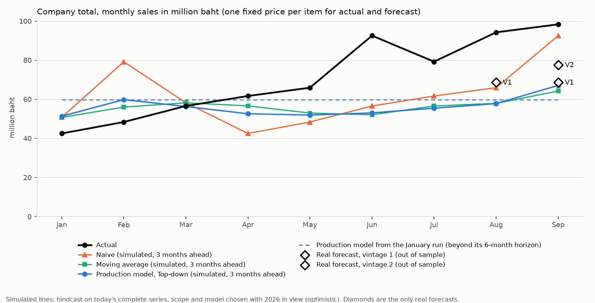
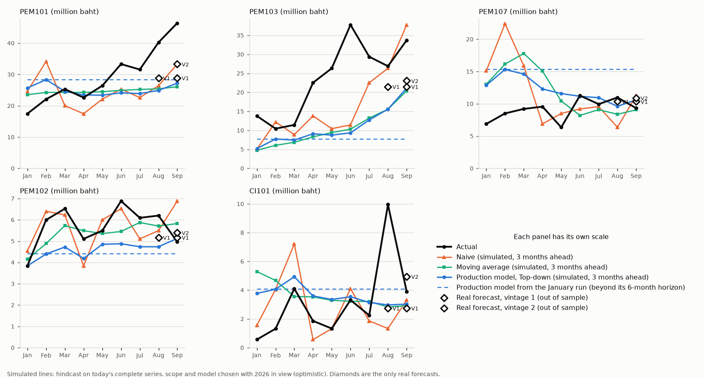

# Hindcast 2026 (Prompt 64, step 3; analysis only)

How accurate the production model would have been from January 2026, with the origin of every run guarded against leakage. No page, forward-test log, vintage, model input or published file was changed (hashes below).

## สรุปสำหรับผู้บริหาร (ไม่เกิน 8 บรรทัด)

1. วิธีทำ: จำลองการรันรายเดือนทุกเดือนตั้งแต่ ต.ค. 68 ถึง ก.ย. 69 ด้วยโมเดลที่ใช้จริง ตัดข้อมูลที่เดือนสุดท้ายที่กติกา 30 วันอนุญาต แล้ววัดผลเดือน ม.ค.–ก.ย. 69 รวม 3,015 ค่า (335 รหัส x 9 เดือน)
2. เทียบกับ Naive (ใช้ยอดเดือนล่าสุดเป็นค่าคาดการณ์) ระดับรหัสสินค้า Relative MAE (ความคลาดเคลื่อนของโมเดลหารด้วยของ Naive) ของโมเดลเท่ากับ 0.82 ต่ำกว่า 1 แปลว่าดีกว่า Naive ส่วนค่าเฉลี่ยเคลื่อนที่ได้ 0.79
3. ดีกว่า Naive ใน PEM101 (0.81), CI101 (0.88), PEM102 (0.95) แต่ไม่ดีกว่าใน PEM107 (1.06) และ PEM103 (1.18)
4. ที่ยอดรวมเป็นบาทรายเดือน (9 เดือน, ยอดขายจริงรวม 639.5 ล้านบาท) ค่าคาดการณ์ต่ำกว่ายอดจริงเฉลี่ย 21% คลาดเคลื่อนเฉลี่ย 19.4 ล้านบาทต่อเดือน ใกล้เคียง Naive (18.4) และค่าเฉลี่ยเคลื่อนที่ (18.8)
5. คาดการณ์ที่ไกลเกิน 6 เดือน (รันต้นปีเดียว) แย่ลง: Relative MAE ราว 0.55–0.68 ในเดือนที่ 2–6 แต่ 0.78–0.90 ในเดือนที่ 7–10
6. คาดการณ์จริงมีเพียง 3 จุด (vintage 1 เดือน ส.ค. และ ก.ย., vintage 2 เดือน ก.ย.) ที่ยอดรวมต่ำกว่ายอดจริง 27%, 30% และ 21%
7. ผลนี้ดูดีเกินจริงในระดับหนึ่ง เพราะโมเดล ขอบเขตสินค้า และค่าพารามิเตอร์ถูกเลือกกลางปี 69 โดยเห็นข้อมูลปี 69 แล้ว และใช้ข้อมูลชุดสมบูรณ์ของวันนี้ ไม่ใช่ข้อมูล ณ วันรันจริง
8. ยังไม่สรุปว่าดีกว่าอย่างมีนัยสำคัญ (ไม่ได้ทดสอบทางสถิติ) และวัดได้เพียง 9 เดือน

## 1. Precondition (confirmed before any run)

- Series: `processed_all_divisions_monthly_qty.csv` of the fresh pull of the Step 2 dry run (a kept temporary copy of the project): 10,385 rows, 335 items, 5 divisions, months 2024-03 to 2026-09, `snapshot_pull_date` 2026-10-30 13:05:36. Same file the monthly runner step 5 reads, keyed on `forecast_date` (`load_data_all_divisions.py`: "Series is keyed on forecast_date"; config `adopted_series_key: forecastDate`).
- Leakage: the project's own `leakage_guard.check_window_closed("2026-09", pull, 30)` PASSED (actual gap 30 days, required `leakage_guard.min_margin_days` 30); the control `2026-10` is refused (`LeakageGuardError`).
- Scope: the current 335 items (`phaseC_step2_scope_335items.csv`, 335 rows).

## 2. Method

**The model is not re-implemented.** The forecasts come from the functions step 5 uses, called in the order of `monthly_refresh.compute_new_vintage`, on a series cut at an origin, with the horizon passed as a parameter (never through config):
`forward_test_all_divisions.build_item_series_div` / `build_type_series_div` -> `item_level_reconciliation.forecast_all_approaches` (Top-down: the Type's equal-weight Combination of Naive, MA, Croston and SBA split to items by historical share over the fit window) -> items with no history get zeros. Baselines: Naive = the last month of the fit window (`models.naive_forecast`); the moving-average comparator = `models.moving_average_forecast` with the window per division of the CURRENT backtest choice (`ma_comparator`).

`compute_new_vintage` itself cannot take a cut series without a code change (fixed series file, a fixed 31-month check, today's date, the real forward-test log), so the driver (`src/investigations/hindcast_2026.py`) was proved equal to production instead:
- on the full series, 2,010 Item rows: 0 unmatched, largest difference 0.00005 against `compute_new_vintage` run inside the copy (step 5's own rounding to 4 decimals);
- on vintage 2's own frozen fit series (`output/forward_test/vintage_series/vintage_002_fit_series.csv.gz`) against the Top-down rows logged for vintage 2: 2,010 rows, 0 unmatched, largest difference 0.00005.

**(A) Simulated monthly runs.** The run day of each month 2025-10 to 2026-09 (`monthly_refresh.run_day`: first weekday on or after the 5th). `fit_last_month` = the latest month the leakage guard accepts at that run date; the series is cut there; horizon 6.

| run (A) | run day | fit_last_month | items with no sale before the fit month |
|---|---|---|---|
| 2025-10 | 2025-10-06 | 2025-08 | 29 |
| 2025-11 | 2025-11-05 | 2025-09 | 27 |
| 2025-12 | 2025-12-05 | 2025-10 | 24 |
| 2026-01 | 2026-01-05 | 2025-11 | 23 |
| 2026-02 | 2026-02-05 | 2025-12 | 19 |
| 2026-03 | 2026-03-05 | 2026-01 | 18 |
| 2026-04 | 2026-04-06 | 2026-02 | 16 |
| 2026-05 | 2026-05-05 | 2026-03 | 12 |
| 2026-06 | 2026-06-05 | 2026-04 | 5 |
| 2026-07 | 2026-07-06 | 2026-05 | 4 |
| 2026-08 | 2026-08-05 | 2026-06 | 4 |
| 2026-09 | 2026-09-07 | 2026-07 | 2 |

The main line for a target month X is the latest simulated run dated before the first day of X: the run of the month before, whose fit month is two months before that, so **the main line is the third month ahead (horizon 3)** for every month of 2026. Accuracy by horizon 1 to 6 uses all runs.

**(B) One start-of-year run.** The January 2026 run day (2026-01-05), fit_last_month 2025-11 (the guard's rule), forecasting every month to 2026-09 (horizon 10, passed as a parameter). **Beyond the production horizon of 6 months**; labelled so everywhere. Months 2026-01 to 2026-09 are scored (horizons 2 to 10).

**Measurement.** Company and each forecast division (PEM104 is not forecast; the company is the five divisions added), monthly, in baht: one fixed price per item applied to actual AND forecast (the executive tab's price chain `reader_values.unit_prices`: average selling price of the last 12 months of the window, else the whole window, else the Price List market price; here the window is the full fresh series 2024-03 to 2026-09: 279 items priced from the recent window, 56 from the fit window, none unpriced), so the error is quantity only. Item level as METRICS Sec.25 and 48: MAE = mean |forecast - actual| over the item-month cells; Relative MAE = sum of the model's |e| / sum of Naive's |e| over the same cells (below 1 = better than Naive); **bias = sum(forecast - actual) / sum(actual)** (analysis only, METRICS Sec.28 note). At the level of the monthly TOTAL the same ratios are taken over the 9 monthly totals. n is next to every figure. No significance test (METRICS Sec.41 only).

## 3. Guards (all in `tests/test_hindcast_2026.py`, 13 tests, mutation-checked)

- Each simulated run's input ends at its fit_last_month (the driver refuses a cut that does not; a test records the input of all 13 runs).
- Canary: changing every value after an origin's fit month (3,350 values multiplied by 7 plus 1,000) leaves that run's forecast unchanged to the last digit (run on the real series for origin 2025-11, and in the tests on a fixture); a value inside the window does move it.
- `config/config.yaml` SHA-256 identical before and after the run (`b3c854a9...1d031d891`): nothing was tuned.
- The current 335-item scope; per run the number of items with no sale before the fit month is in the table above.
- No write to the forward-test log, vintages, model inputs or published files: the file manifests of `D:\sale_forecast` and the publishing clone before and after contain no changed or removed file; the 8 forward-test log, metadata and shadow files have identical SHA-256; the only new files are this report, its two charts, the analysis scripts and test, `output/summary/hindcast_2026_forecasts.csv` and `output/summary/hindcast_2026_tables/` (untracked), and `output/state/source_guard_base.json` written deliberately in Step 2.

## 4. Results: simulated runs (A), main line (third month ahead), January to September 2026

Item level, n = item-month cells (335 items x 9 months for the company; cells where actual and forecast are both 0 count in n and add nothing to the ratios).

| | n | MAE Top-down | MAE Naive | MAE MA | Relative MAE Top-down | Relative MAE MA | bias Top-down | bias Naive | bias MA |
|---|---|---|---|---|---|---|---|---|---|
| Company | 3,015 | 128.1 | 156.6 | 124.2 | **0.82** | 0.79 | -10.3% | -11.7% | -6.0% |
| PEM101 | 1,296 | 288.8 | 355.6 | 280.0 | 0.81 | 0.79 | -10.8% | -12.0% | -6.3% |
| PEM103 | 450 | 5.6 | 4.7 | 5.1 | **1.18** | 1.08 | -52.8% | -23.5% | -51.3% |
| PEM107 | 1,008 | 8.3 | 7.8 | 8.2 | **1.06** | 1.04 | +94.8% | +56.1% | +73.3% |
| PEM102 | 144 | 1.2 | 1.2 | 1.0 | 0.95 | 0.85 | -12.4% | -0.5% | -5.1% |
| CI101 | 117 | 8.1 | 9.2 | 9.0 | 0.88 | 0.97 | +29.8% | +22.7% | +25.2% |

(Quantity units per cell; MAE is the mean over all cells of the group, so it is diluted by zero cells.) Relative MAE above 1 means worse than Naive: PEM103 and PEM107.

**Monthly total in baht** (main line, 9 months, million baht; n = 9 months per row):

| | actual (9 months) | MAE of the monthly total Top-down | Naive | MA | bias Top-down | bias Naive | bias MA | Relative MAE Top-down | Relative MAE MA |
|---|---|---|---|---|---|---|---|---|---|
| Company | 639.5 | 19.40 | 18.35 | 18.78 | -21.0% | -13.1% | -21.0% | 1.06 | 1.02 |
| PEM101 | 265.4 | 7.82 | 8.65 | 6.97 | -15.0% | -14.8% | -16.2% | 0.90 | 0.81 |
| PEM103 | 212.4 | 12.81 | 8.39 | 13.06 | -54.3% | -30.1% | -55.3% | 1.53 | 1.56 |
| PEM107 | 82.0 | 3.33 | 4.74 | 4.30 | +32.9% | +28.2% | +30.7% | 0.70 | 0.91 |
| PEM102 | 51.1 | 1.11 | 0.79 | 0.64 | -18.8% | -0.2% | -5.2% | 1.40 | 0.80 |
| CI101 | 28.6 | 2.17 | 2.06 | 2.38 | +13.4% | -11.5% | +13.8% | 1.05 | 1.16 |

The company total is under-forecast by all three methods; at the level of the total the model is not better than Naive (Relative MAE 1.06, n = 9), while at the level of the single item it is (0.82, n = 3,015).

### Accuracy by horizon, company, item level (all simulated runs A, 2026-01 to 2026-09)

| horizon | n | MAE Top-down | MAE Naive | MAE MA | Relative MAE Top-down | Relative MAE MA | bias Top-down |
|---|---|---|---|---|---|---|---|
| 1 | 2,680 | 114.2 | 133.5 | 121.6 | 0.86 | 0.91 | -8.4% |
| 2 | 3,015 | 130.1 | 176.8 | 125.3 | 0.74 | 0.71 | -9.2% |
| 3 | 3,015 | 128.1 | 156.6 | 124.2 | 0.82 | 0.79 | -10.3% |
| 4 | 3,015 | 137.5 | 184.1 | 127.8 | 0.75 | 0.70 | -9.7% |
| 5 | 3,015 | 143.8 | 199.7 | 129.3 | 0.72 | 0.65 | -8.2% |
| 6 | 2,680 | 141.8 | 203.1 | 127.1 | 0.70 | 0.63 | -12.6% |

(Horizon 1 and 6 have fewer cells: no run reaches every month at those horizons. By division: `output/summary/hindcast_2026_tables/A_by_horizon_item_by_division.csv`.)

## 5. Results: the start-of-year run (B), beyond the production horizon

Fit_last_month 2025-11, one forecast for every month; company, item level, n = 335 items per horizon (one month each). **Beyond the production horizon of 6 months.**

| horizon | month | n | MAE Top-down | MAE Naive | MAE MA | Relative MAE Top-down | Relative MAE MA | bias Top-down |
|---|---|---|---|---|---|---|---|---|
| 2 | 2026-01 | 335 | 194.7 | 287.3 | 156.1 | 0.68 | 0.54 | +97.2% |
| 3 | 2026-02 | 335 | 107.9 | 174.2 | 97.8 | 0.62 | 0.56 | +11.7% |
| 4 | 2026-03 | 335 | 95.4 | 166.3 | 92.7 | 0.57 | 0.56 | +15.3% |
| 5 | 2026-04 | 335 | 129.1 | 222.6 | 103.6 | 0.58 | 0.47 | +27.1% |
| 6 | 2026-05 | 335 | 111.1 | 200.7 | 85.8 | 0.55 | 0.43 | +20.9% |
| 7 | 2026-06 | 335 | 120.5 | 135.7 | 148.7 | **0.89** | 1.10 | -17.0% |
| 8 | 2026-07 | 335 | 143.2 | 163.9 | 162.2 | **0.87** | 0.99 | -14.7% |
| 9 | 2026-08 | 335 | 173.5 | 193.6 | 178.6 | **0.90** | 0.92 | -2.1% |
| 10 | 2026-09 | 335 | 143.9 | 185.2 | 162.7 | **0.78** | 0.88 | -14.2% |

Monthly company total in baht over the 9 months (n = 9): MAE 18.33 million baht (Naive 18.72, MA 19.73), bias -15.8% (Naive +11.5%, MA -21.2%), Relative MAE 0.98 (MA 1.05). By division (item level): PEM101 0.70, PEM102 0.80, PEM103 0.85, PEM107 0.73, CI101 1.54 (worse than Naive). The advantage over Naive shrinks beyond month 6 (0.78 to 0.90 against 0.55 to 0.68 before), and the moving average loses it (0.88 to 1.10).

## 6. The real forecasts (the only true out-of-sample points)

Vintage 1 (run 2026-09-07, fit_last_month 2026-07) for 2026-08 and 2026-09, vintage 2 (run 2026-10-02, fit_last_month 2026-08) for 2026-09, Top-down as logged, scored against today's series; Naive and the moving average for the same vintages are computed from the series cut at each vintage's fit month (labelled simulated). n = 335 items per cell.

| vintage | month | horizon | Relative MAE Top-down (item) | bias Top-down (item) | company actual (million baht) | Top-down | Naive | MA |
|---|---|---|---|---|---|---|---|---|
| 1 | 2026-08 | 1 | 0.88 | -4.9% | 94.25 | 68.68 (-27.1%) | 79.25 (-15.9%) | 67.91 (-27.9%) |
| 1 | 2026-09 | 2 | 0.84 | -16.6% | 98.32 | 68.68 (-30.1%) | 79.25 (-19.4%) | 67.91 (-30.9%) |
| 2 | 2026-09 | 1 | 0.82 | -17.1% | 98.32 | 77.62 (-21.1%) | 94.25 (-4.1%) | 73.87 (-24.9%) |

At the item level the real forecasts beat Naive (Relative MAE 0.82 to 0.88, n = 335 each); at the company total in baht all three points are 21% to 30% under the actual, and Naive was closer each time. Three points are not evidence of a pattern.

## 7. Limitations (read before using any figure)

1. **Optimistic by construction.** The model (the Combination of Naive, MA, Croston and SBA and the Top-down split), its parameters, the 335-item scope and the moving-average windows were chosen in mid-2026 with 2026 data in view; the windows come from the current backtest, which includes months of 2026. Nothing was tuned in this analysis (config hash unchanged), but the choices were not made blind.
2. **Fit data is today's complete series, not the data as it stood on each run date.** Where it can be checked, the series did not change: vintage 2's frozen fit series (pulled 2026-10-05) equals today's series (pulled 2026-10-30) in all 10,050 overlapping cells (months 2024-03 to 2026-08). Earlier restatements cannot be checked (no earlier frozen series).
3. **The fit window starts at 2024-03 for every run.** The production window is a rolling 31 months (vintage 2 starts at 2024-02), the fresh grid starts at 2024-03, so each simulated run has one month less history than production would have had (early runs 18 months, the last 29). Measured on vintage 2: the six-month Top-down total differs by -0.05% for the company and by -3.4% (CI101) to +2.2% (PEM107) for divisions, and 1,632 of 2,010 item-horizon values differ by more than 1% (mostly small items).
4. **The scored period is short**: 9 months, n = 9 for every total-level figure. No significance claim is made (METRICS Sec.41 defines the only one used in the project).
5. **Main line = third month ahead.** The production vintage of the month before the target forecasts it three months ahead, because the leakage guard keeps the last two months out of the fit.
6. Items with no sale before a run's fit month are forecast 0 by every method (29 in the first run, 2 in the last); items that start selling later are therefore always under-forecast, which contributes to the negative bias.
7. MAE is a mean over all cells of the group and is diluted by cells where both are 0; Relative MAE and bias are not affected.
8. PEM104 is not forecast (made to order). The company is the five forecast divisions added; its baht total adds different units priced item by item.
9. One fixed price per item comes from the last 12 months of the full series (to 2026-09): it puts the same scale on actual and forecast, but it uses 2026 prices for 2026 months.
10. The January run (B) is beyond the production horizon and is reported for the shape of the error over longer horizons only.

## 8. Reproduction

`python src/monthly_refresh.py --dry-run --skip-tests` (a kept copy: its step 1 pulls the series), then `python src/investigations/hindcast_2026_run.py <copy>`, then `python src/investigations/hindcast_2026_charts.py`. Outputs: `output/summary/hindcast_2026_forecasts.csv` (every simulated forecast row: run, item, target month, horizon, Top-down, Naive, MA, actual, price), `output/summary/hindcast_2026_tables/` and the two charts here. The Step 2 pull of this analysis: 2026-10-30 13:05, six read-only logins.
